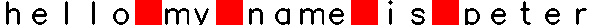
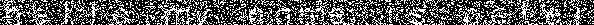
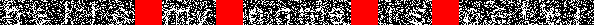
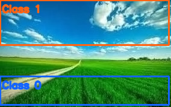
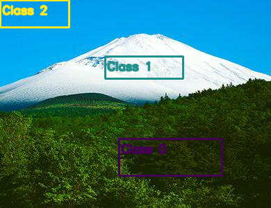
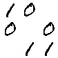
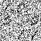
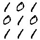

# Structural Methods of Pattern Recognition

**Table of contents**

- [Lab 1. Recognition of spaces](#lab-1--recognition-of-spaces)
- [Lab 2. Sudoku](#lab-2---sudoku)
- [Lab 3. Image Segmentation (2 classes)](#lab-3---image-segmentation-2-classes)
- [Lab 4. Image Segmentation (3 classes)](#lab-4---image-segmentation-3-classes)
- [Lab 5. Binary addition](#lab-5---binary-addition-cockeyoungerkasami-algorithm)


**Mathematical solutions for the course**

- [solutions.pdf](spr-solutions.pdf)

## Setup

To run these applications, you need to have **Python3.12**.

1. Clone repo.

2. Create virtual environment.
    ```bash
    python3.12 -m venv .venv
    ```
3. Activate it
    ```bash
    source .venv/bin/activate
    ```
4. Install the package:
    ```bash
    pip install -e .
    ```

## Lab 1 – Recognition of spaces

### Description
> The program converts a string to a noisy image and then decodes space.

### Usage
```commandline
$ find-spaces --help
usage: find-spaces [-h] --input_string INPUT_STRING --noise_level NOISE_LEVEL [--seed SEED]

Find spaces in a noisy text image.

options:
  -h, --help            show this help message and exit
  --input_string INPUT_STRING
                        Input string.
  --noise_level NOISE_LEVEL
                        Noise level [0, 1].
  --seed SEED           Random seed.
```

### Examples

```text
$ find-spaces --input_string "Hello my name is John" --noise_level 0.7
Ground-truth spaces: [5, 8, 13, 16]
Predicted spaces: [5, 8, 13, 16]
Debug images have been saved successfully.
```

| Original image with ground-truth spaces       |              Noisy image               | Decoded image                     |
|-----------------------------------------------|:--------------------------------------:|-----------------------------------|
|                 |  |  |


## Lab 2 - Sudoku

### Description
Sudoku solver using OR-AND constraint satisfaction method.

### Usage
```commandline
$ sudoku-solver --help
usage: sudoku-solver [-h] sudoku_number

positional arguments:
  sudoku_number  number of sudoku in dataset

options:
  -h, --help     show this help message and exit
```

### Examples
```text
$ sudoku-solver 1
sudoku
**************************************************
[[6 2 0 9 5 1 0 0 0]
 [0 0 5 4 0 0 1 9 6]
 [9 0 1 0 7 0 0 2 8]
 [7 0 4 2 0 0 8 0 1]
 [0 8 0 6 1 0 4 3 0]
 [1 0 9 0 4 3 2 0 0]
 [8 1 0 7 0 4 0 0 2]
 [0 5 7 0 0 9 3 8 0]
 [0 9 0 0 8 2 6 1 0]]
solution
**************************************************
[[6 2 8 9 5 1 7 4 3]
 [3 7 5 4 2 8 1 9 6]
 [9 4 1 3 7 6 5 2 8]
 [7 3 4 2 9 5 8 6 1]
 [5 8 2 6 1 7 4 3 9]
 [1 6 9 8 4 3 2 7 5]
 [8 1 6 7 3 4 9 5 2]
 [2 5 7 1 6 9 3 8 4]
 [4 9 3 5 8 2 6 1 7]]
```

## Lab 3 - Image Segmentation (2 classes)

### Description
Two-class image segmentation with diffusion, a smooth-border check, and optional
epsilon crossing-out/self-control. Labs 3 and 4 share one optimized engine and
the same command-line options; Lab 3 also keeps `--n_rows` as a shortcut for
full-width top/bottom seed boxes.

### Usage
```commandline
$ segmenter-2 --help
usage: segmenter-2 [-h] --image_path IMAGE_PATH [--class0_bbox Y0 Y1 X0 X1] [--class1_bbox Y0 Y1 X0 X1]
                   [--beta BETA] [--n_diffusion_iter N_DIFFUSION_ITER] [--max_iter MAX_ITER] [--use_crossing_out]
                   [--crossing_epsilon CROSSING_EPSILON] [--no-debug]

Segment an image into 2 classes using diffusion.

options:
  -h, --help            show this help message and exit
  --image_path IMAGE_PATH
                        Input image path
  --class0_bbox Y0 Y1 X0 X1
                        Seed box for class 0, in Y0 Y1 X0 X1 order
  --class1_bbox Y0 Y1 X0 X1
                        Seed box for class 1, in Y0 Y1 X0 X1 order
  --beta BETA           Boundary smoothness penalty
  --n_diffusion_iter N_DIFFUSION_ITER
                        Diffusion steps per outer iteration
  --max_iter MAX_ITER   Maximum outer iterations
  --use_crossing_out    Use epsilon crossing-out/self-control
  --crossing_epsilon CROSSING_EPSILON
                        Tolerance for near-max candidates
  --no-debug            Disable debug seed-box overlays
```

### Examples

**Diffusion**
```commandline
segmenter-2 --image_path labs/lab34/test_images/img1.jpg \
    --class0_bbox 126 174 0 281 \
    --class1_bbox 0 75 0 281 \
    --beta 10 \
    --n_diffusion_iter 5
```

**Crossing Out**
```commandline
segmenter-2 --image_path labs/lab34/test_images/img1.jpg \
    --class0_bbox 126 174 0 281 \
    --class1_bbox 0 75 0 281 \
    --n_diffusion_iter 5 \
    --use_crossing_out
```


| Seed boxes                               |  Segmentation (Diffusion)                                | Segmentation (Crossing Out)                          |
|------------------------------------------|----------------------------------------------------------|------------------------------------------------------|
|  |   |  |


## Lab 4 - Image Segmentation (3 classes)

### Description
Three-class image segmentation using the same diffusion engine.

### Usage
```commandline
$ segmenter-3 --help
usage: segmenter-3 [-h] --image_path IMAGE_PATH [--class0_bbox Y0 Y1 X0 X1] [--class1_bbox Y0 Y1 X0 X1]
                   [--class2_bbox Y0 Y1 X0 X1] [--beta BETA] [--n_diffusion_iter N_DIFFUSION_ITER]
                   [--max_iter MAX_ITER] [--use_crossing_out] [--crossing_epsilon CROSSING_EPSILON] [--no-debug]

Segment an image into 3 classes using diffusion.

options:
  -h, --help            show this help message and exit
  --image_path IMAGE_PATH
                        Input image path
  --class0_bbox Y0 Y1 X0 X1
                        Seed box for class 0, in Y0 Y1 X0 X1 order
  --class1_bbox Y0 Y1 X0 X1
                        Seed box for class 1, in Y0 Y1 X0 X1 order
  --class2_bbox Y0 Y1 X0 X1
                        Seed box for class 2, in Y0 Y1 X0 X1 order
  --beta BETA           Boundary smoothness penalty
  --n_diffusion_iter N_DIFFUSION_ITER
                        Diffusion steps per outer iteration
  --max_iter MAX_ITER   Maximum outer iterations
  --use_crossing_out    Use epsilon crossing-out/self-control
  --crossing_epsilon CROSSING_EPSILON
                        Tolerance for near-max candidates
  --no-debug            Disable debug seed-box overlays
```

### Example

**Diffusion**
```bash
segmenter-3 --image_path labs/lab34/test_images/img2.jpg \
  --class0_bbox 200 254 171 320 \
  --class1_bbox 81 114 151 264 \
  --class2_bbox 0 40 0 100 \
  --beta 2 --n_diffusion_iter 10 --max_iter 100
```

**Crossing Out**
```bash
segmenter-3 --image_path labs/lab34/test_images/img2.jpg \
  --class0_bbox 200 254 171 320 \
  --class1_bbox 81 114 151 264 \
  --class2_bbox 0 40 0 100 \
  --beta 2 --n_diffusion_iter 10 --max_iter 1000 --use_crossing_out
```

| Seed boxes                               |  Segmentation (Diffusion)                                | Segmentation (Crossing Out)                          |
|------------------------------------------|----------------------------------------------------------|------------------------------------------------------|
|  |   |  |


## Lab 5 -  Binary addition (Cocke–Younger–Kasami algorithm)

### Description
Decoding and finding empty spaces to satisfy binary addition.

### Usage
```commandline
$ binary-addition --help
usage: binary-addition [-h] input_string noise_level

Binary addition using Cocke–Younger–Kasami algorithm for decoding noisy images.

positional arguments:
  input_string  Equation string (first summand, second summand, solution). Use '#' for spaces.
  noise_level   Noise level probability for the Bernoulli distribution.

options:
  -h, --help    show this help message and exit
```


#### Examples
```commandline
binary-addition '10# 0#0 #11' 0.3
```

| Input                                    |  Noisy image                            | Solution                           |
|------------------------------------------|-----------------------------------------|------------------------------------|
|   |    |   |


## Authors

- Maksym Shylo ([@maksymshylo](https://github.com/maksymshylo))
- Ruslan Khomenko ([@Ruslan3584](https://github.com/Ruslan3584))
